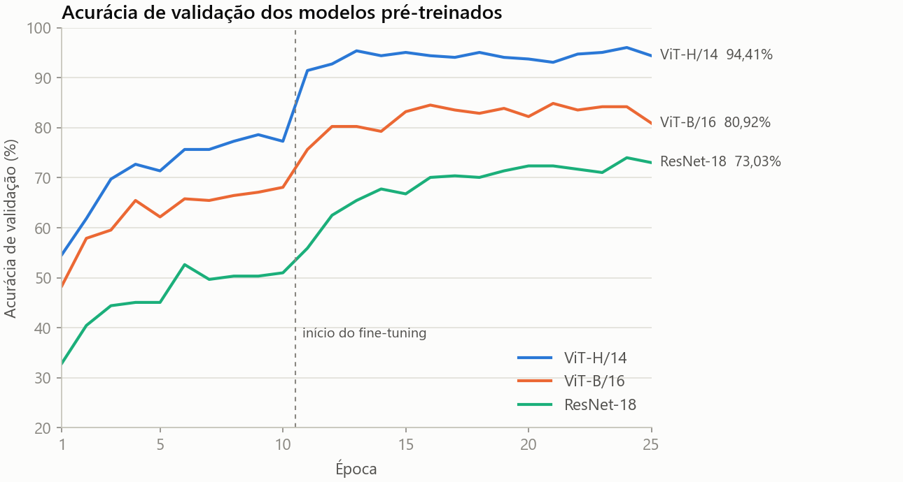
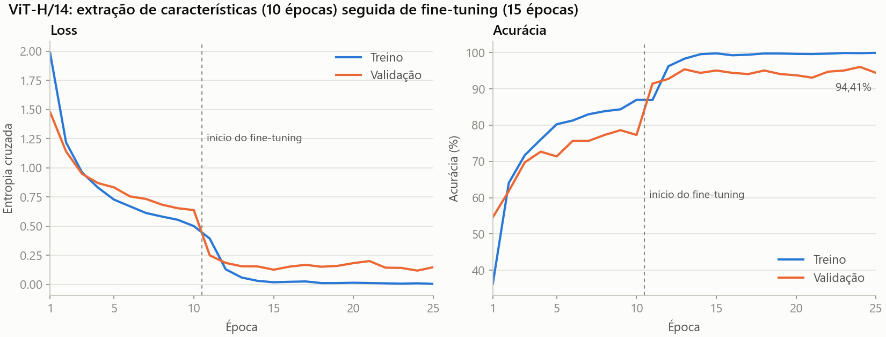
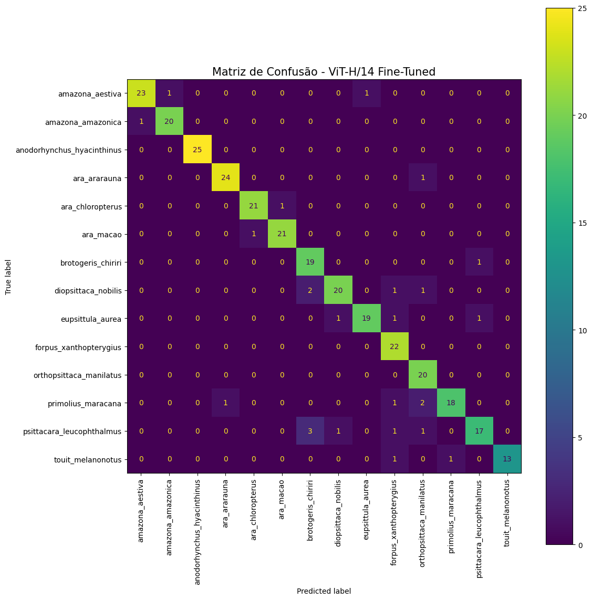
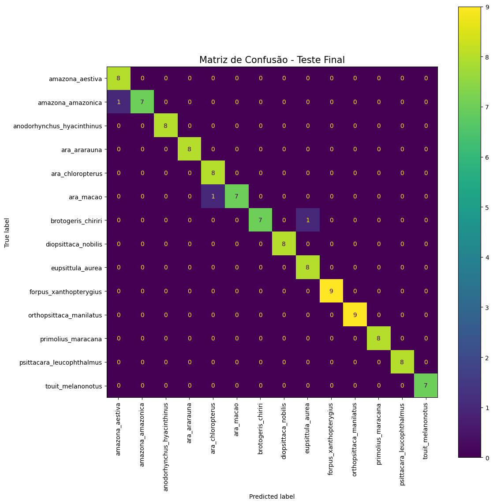

# Classificador de pássaros do Cerrado

Classificação de 14 espécies de psitacídeos do Cerrado a partir de fotos, comparando uma CNN treinada do zero com ResNet-18, ViT-B/16 e ViT-H/14 pré-treinados e ajustados por fine-tuning.

[](https://colab.research.google.com/github/raqueleucaria/cerrado-birds-classifier/blob/main/notebooks/01_classificador_vit_h14.ipynb)

> Trabalho da disciplina *Tópicos Especiais em Matemática Aplicada: Deep Learning* (UnB, 2025), feito em grupo. Veja [Autores](#autores).

## Resultados

| Modelo | Conjunto avaliado | Acurácia | Precisão (macro) | Recall (macro) | F1 (macro) |
| :--- | :--- | :---: | :---: | :---: | :---: |
| CNN do zero, execução A | Teste interno (308 imagens) | 10% | 11% | 9% | 4% |
| CNN do zero, execução B | Teste interno (308 imagens) | 15,58% | 9,37% | 14,38% | 9,60% |
| ResNet-18, fine-tuning | Teste interno (308 imagens) | 69% | 70% | 69% | 69% |
| ViT-B/16, fine-tuning | Teste interno (308 imagens) | 83% | 84% | 83% | 83% |
| **ViT-H/14, fine-tuning** | **Teste interno (308 imagens)** | **91,56%** | **92,05%** | **91,52%** | **91,44%** |
| **ViT-H/14, fine-tuning** | **Base final do professor (113 imagens)** | **97,35%** | **97,62%** | **97,32%** | **97,31%** |

**Como ler a tabela:**

- A comparação justa entre modelos é a do **teste interno**, em que todos usam as mesmas 308 imagens. Nela, o ViT-H/14 fica 8 pontos de F1 acima do ViT-B/16 e 22 acima da ResNet-18.
- O 97% do ViT-H/14 vem de uma base separada e menor, com 7 a 9 imagens por classe (3 erros em 113), e não deve ser comparado às outras linhas.
- A CNN do zero tem duas execuções porque cada notebook treinou a sua, com diferenças de padding, batch size e augmentation. As duas ficam perto do acaso (7% para 14 classes) e servem apenas como linha de base. A CNN também aparece com 20,07% nos notebooks: esse valor é a acurácia de **validação** da execução B, cujo teste é 15,58%.





| Teste interno (308 imagens) | Base final do professor (113 imagens) |
| :---: | :---: |
|  |  |

No teste interno, a classe mais difícil foi *Psittacara leucophthalmus* (F1 de 80,95%; 6 de 23 imagens atribuídas a outras espécies). As matrizes dos demais modelos estão em [`assets/`](assets/).

## O que aprendemos

- **Reaproveitar pesos compensa em bases pequenas.** Com cerca de 2.400 imagens de treino e 15 épocas, a CNN do zero ficou perto do acaso, enquanto todos os modelos pré-treinados chegaram a pelo menos 69% de F1 no mesmo teste.
- **O fine-tuning fez diferença real.** Descongelar a rede com lr de 1e-5 elevou a acurácia de validação da ResNet-18 de 50,99% para 73,03%, a do ViT-B/16 de 68,09% para 80,92% e a do ViT-H/14 de 77,30% para 94,41%.
- **Acurácia sozinha esconde falhas.** Na execução B, a CNN tem 15,58% de acurácia, mas 9 das 14 classes ficam com F1 zero. Ela atribui muitas imagens a *Diopsittaca nobilis*, com recall de 83,33% e precisão de só 8,93%, o que só aparece nas métricas por classe.
- **A matriz de confusão mostra onde o problema é visual.** A ResNet-18 confunde *Ara chloropterus* e *Ara macao*, duas araras vermelhas (7 e 6 erros em 22 imagens de cada). O ViT-H/14 reduz isso a 1 erro em cada sentido, embora a comparação não permita atribuir o ganho a um único fator.
- **Todo número precisa de contexto.** Ao revisar o trabalho para esta publicação, vimos que o mesmo modelo tem 91,56% em uma base e 97,35% em outra, e que a CNN tinha resultados de treinos diferentes misturados no texto. Agora registramos conjunto, tamanho da amostra e execução de cada métrica.

## Dataset

- **Conteúdo:** 3.037 imagens de 14 espécies da família Psittacidae, divididas em 2.425 para treino, 304 para validação e 308 para teste (holdout 80/10/10 por espécie).
- **Origem e download:** [base disponibilizada pelo professor da disciplina](https://tinyurl.com/5y3tkb74). As imagens não são redistribuídas aqui, e a licença da base não está documentada na fonte.
- **Base final:** as 113 imagens usadas na avaliação final foram fornecidas separadamente pelo professor e não têm link nos notebooks.

Para executar os notebooks, coloque os dados nesta estrutura (no Colab, faça upload ou ajuste `MAIN_DIR`):

```text
data/passaros/
├── dataset/<especie>/*.jpg
├── dataset_split/          # criada pelo notebook
└── Aves_teste_final/<especie>/*.jpg
```

<details>
<summary>As 14 espécies</summary>

*Amazona aestiva*, *Amazona amazonica*, *Anodorhynchus hyacinthinus*, *Ara ararauna*, *Ara chloropterus*, *Ara macao*, *Brotogeris chiriri*, *Diopsittaca nobilis*, *Eupsittula aurea*, *Forpus xanthopterygius*, *Orthopsittaca manilatus*, *Primolius maracana*, *Psittacara leucophthalmus* e *Touit melanonotus*.

</details>

## Abordagem

Todas as imagens são redimensionadas para 224×224 e normalizadas com a média e o desvio-padrão da ImageNet. O treino usa espelhamento horizontal, rotação e variação de cor.

| Modelo | Estratégia | Notebook |
| :--- | :--- | :--- |
| CNN do zero | 3 blocos convolucionais e 2 camadas densas, 15 épocas, Adam (lr 1e-3) | [`01`](notebooks/01_classificador_vit_h14.ipynb) e [`02`](notebooks/02_anexo_resnet18.ipynb) |
| ResNet-18 | ImageNet: 10 épocas só no classificador (lr 1e-3), depois 15 épocas na rede inteira (lr 1e-5) | [`02`](notebooks/02_anexo_resnet18.ipynb) |
| ViT-B/16 | ImageNet: mesmo esquema de 10 + 15 épocas | [`03`](notebooks/03_anexo_vit_b16.ipynb) |
| ViT-H/14 | SWAG (`IMAGENET1K_SWAG_LINEAR_V1`): mesmo esquema de 10 + 15 épocas | [`01`](notebooks/01_classificador_vit_h14.ipynb) |

**Execução.** O notebook `01` é o principal e deve rodar primeiro, porque cria a divisão treino/validação/teste usada pelos três. O `02` e o `03` são anexos com os demais experimentos. O ViT-H/14 rodou no Colab com GPU A100 e RAM alta; a ResNet-18 e o ViT-B/16, em GPU T4. O badge do Colab abre o notebook sem os dados, que precisam ser colocados em `data/passaros` (veja [Dataset](#dataset)).

Os notebooks guardam as saídas da execução original. Para esta versão, foram removidos caminhos pessoais, warnings, código sem uso, amostras de imagens do dataset e textos duplicados. A teoria está resumida em [Fundamentos](#fundamentos), e a análise, nesta página. Os números foram conferidos nas saídas, e nenhum resultado foi alterado.

## Fundamentos

<details>
<summary>Teoria resumida: imagens, métricas, transfer learning e arquiteturas</summary>

### Da imagem à classificação

Para o computador, uma imagem colorida é uma matriz de altura × largura × 3 canais (RGB). A classificação supervisionada aprende, a partir de exemplos rotulados, uma função que leva essa matriz a uma das classes, ajustando os parâmetros por gradiente descendente para minimizar uma função de perda.

- **Pré-processamento:** imagens de resoluções variadas são levadas a um tamanho fixo e normalizadas. Aqui, com as estatísticas da ImageNet, as mesmas dos modelos pré-treinados.
- **Holdout:** treino, validação e teste ficam separados. O teste mede a generalização em imagens que não participaram do treino.
- **Data augmentation:** transformações aleatórias só no treino, para que o modelo seja menos sensível a variações de pose, luz e cor, reduzindo o overfitting. As classes têm tamanhos parecidos (15 a 25 imagens por classe no teste), e não foi usada nenhuma técnica específica de balanceamento.

### Métricas

| Métrica | Fórmula | Pergunta que responde |
| :--- | :--- | :--- |
| Acurácia | acertos / total | Quantas predições estão corretas no geral? |
| Precisão | VP / (VP + FP) | Quando o modelo prevê a classe X, quantas vezes acerta? |
| Recall | VP / (VP + FN) | Das imagens que são da classe X, quantas ele encontra? |
| F1 | 2 × precisão × recall / (precisão + recall) | A precisão e o recall estão equilibrados? |

VP, FP e FN são verdadeiros positivos, falsos positivos e falsos negativos. A média **macro** dá o mesmo peso a todas as classes, por isso a usamos para comparar os modelos. A **matriz de confusão** mostra quais espécies são confundidas entre si.

### Transfer learning e fine-tuning

*Transfer learning* reaproveita o que um modelo aprendeu em uma base grande, como a ImageNet, porque bordas, texturas e formas são úteis em muitas tarefas visuais. Todos os modelos pré-treinados passaram por duas etapas:

1. **Extração de características:** a rede fica congelada e só o novo classificador de 14 classes é treinado.
2. **Fine-tuning:** toda a rede é descongelada e treinada com taxa de aprendizado bem menor, adaptando-se às espécies sem perder o que já sabia.

### Arquiteturas

- **CNN:** camadas de convolução e pooling aprendem padrões em hierarquia, de bordas a formas mais complexas.
- **ResNet-18:** versão leve da família ResNet. As conexões residuais fazem cada bloco aprender a diferença `F(x) = H(x) − x`, com saída `F(x) + x`, o que facilita o fluxo do gradiente e o treino de redes profundas.
- **Vision Transformer (ViT):** divide a imagem em patches, transforma cada um em um vetor com informação de posição e os processa com autoatenção, o que relaciona regiões distantes desde a primeira camada.

| Variante | Tamanho | Patch | Patches em 224×224 | Parâmetros* |
| :--- | :--- | :---: | :---: | :---: |
| ViT-B/16 | Base | 16×16 | 196 | 86,6 milhões |
| ViT-H/14 | Huge | 14×14 | 256 | 632 milhões |

\* Contagens dos modelos originais do torchvision, com 1.000 classes.

O ViT-H/14 tem mais capacidade de representação, mas custa mais para treinar e servir.

</details>

## Limitações e próximos passos

**Limitações**

- **Amostras pequenas:** pelo intervalo de confiança de Wilson (95%), calculado a partir das contagens, a acurácia do ViT-H/14 fica entre 87,9% e 94,2% no teste interno e entre 92,5% e 99,1% na base final.
- **Base final não auditada:** o trabalho não verificou se há imagens repetidas ou quase repetidas entre a base final e o dataset de treino.
- **Comparação não controlada:** o ViT-H/14 usou batch 128, rotação de 15° e precisão mista; a ResNet-18 e o ViT-B/16 usaram batch 32 e rotação de 20°. O teste interno é o mesmo, mas a diferença de desempenho não se deve só à arquitetura.
- **Seleção otimista:** a arquitetura final foi escolhida olhando os resultados nesse mesmo teste interno, o que tende a favorecer o modelo escolhido.
- **Sem reprodutibilidade exata:** o split e os treinos não usam seed fixa, e os pesos treinados não foram salvos.
- **Overfitting:** ao final do treino, o ViT-H/14 tem 99,92% de acurácia no treino e 94,41% na validação. Foram usados os pesos da última época, sem seleção pela validação.
- **Escopo fechado:** o modelo sempre responde uma das 14 espécies, mesmo para fotos de outras aves ou de outros objetos.
- **Custo:** o ViT-H/14 tem 632 milhões de parâmetros (cerca de 2,4 GB), um peso alto para inferência em CPU.

**Próximos passos**

1. Fixar seeds, salvar checkpoints e selecionar a melhor época pela validação.
2. Procurar duplicatas entre treino, teste e base final com hash perceptual.
3. Avaliar com validação cruzada estratificada e usar os mesmos hiperparâmetros em todos os modelos.
4. Adicionar rejeição de entradas fora das 14 espécies.
5. Comparar o ganho do ViT-H/14 com modelos mais leves, considerando latência e tamanho.

## Autores

Eliseu Kadesh, Pedro Barbosa e Raquel Eucaria.

Trabalho desenvolvido em grupo na disciplina *Tópicos Especiais em Matemática Aplicada: Deep Learning*, ministrada pelo Prof. Vinicius Rispoli na Faculdade de Ciências e Tecnologias em Engenharia (UnB Gama), em 2025.

## Licença

O código está sob a licença [MIT](LICENSE), que não cobre o dataset. Os pesos SWAG usados como base do ViT-H/14 têm [licença própria, CC BY-NC 4.0](https://github.com/facebookresearch/SWAG/blob/main/LICENSE), de uso não comercial.

## Referências

- Base de imagens de Psittacidae, disponibilizada pelo Prof. Vinicius Rispoli: <https://tinyurl.com/5y3tkb74>. Acesso em: 14 out. 2025.
- He, K. et al. [Deep Residual Learning for Image Recognition](https://arxiv.org/abs/1512.03385). 2015.
- Dosovitskiy, A. et al. [An Image is Worth 16x16 Words](https://arxiv.org/abs/2010.11929). 2020.
- Singh, M. et al. [Revisiting Weakly Supervised Pre-Training of Visual Perception Models](https://arxiv.org/abs/2201.08371) (SWAG). 2022.
- PyTorch. [Torchvision: modelos pré-treinados](https://docs.pytorch.org/vision/main/models.html).
- WikiAves. [Psittacidae](https://www.wikiaves.com.br/wiki/psittacidae). Acesso em: 14 out. 2025.
